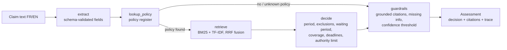

# Insurance Claims Agent

[](https://github.com/Amenflh/insurance-claims-agent/actions/workflows/ci.yml)

An agentic pipeline that reads a free-text insurance claim (French or English), extracts the key facts, retrieves the
relevant clauses of the policy wording, and returns a **coverage decision with cited articles**: `covered`,
`excluded` or `needs_review`. Guardrails send uncertain or incomplete cases to a human claims handler, and every step
is traced.

> **All data in this repository is synthetic.** The policy wordings, the policy register and the 60 claims were
> written for this project. They do not come from any insurer or real person.

## Business problem

Claims teams spend a large share of their time on first-notice-of-loss triage: reading the declaration, finding the
contract, checking the period of cover, the applicable guarantee and the exclusions, and deciding whether a case can
be settled quickly or needs an expert. This project automates the routine part of that triage while keeping the
adjuster in control:

- each decision comes with the policy articles that justify it, so it can be checked in seconds;
- the agent is designed to **fail safe**: when in doubt it routes to a human rather than approving;
- the whole pipeline runs **without any paid LLM** (deterministic `offline` backend), and an LLM can be plugged in
  through an environment variable.

## Architecture



| Step | What it does | Code |
|---|---|---|
| Orchestration | LangGraph `StateGraph` with a conditional edge (no policy goes straight to human review); each node records a trace step | `claims_agent/graph.py` |
| Extraction | Claim type (15 perils), incident date, amount and currency (FR/EN number formats, Tunisian millimes), policy number, third party. Validated by Pydantic | `extraction.py`, `schemas.py` |
| Retrieval | Pure-Python BM25 and TF-IDF cosine over policy articles, fused with Reciprocal Rank Fusion, filtered by product. Articles carry bilingual keyword annotations so an English claim can match a French wording | `retrieval.py` |
| Decision | Offline reasoner that only sees the retrieved clauses plus the product's condition clauses. Exclusions override coverage; negation-aware trigger matching ("no alcohol was involved" does not fire the alcohol exclusion) | `decision.py` |
| Guardrails | Drops citations that are not in the retrieved text, refuses to approve with missing fields or low confidence, routes to a human | `guardrails.py` |
| Backends | `offline` (default), `openai` (any OpenAI-compatible endpoint) or `ollama`. LLM output is validated with the same schemas and falls back to offline rules on error | `llm.py` |
| API | FastAPI `POST /claims/assess`, `GET /health` | `api.py` |

Data: `data/policies/` holds three synthetic wordings (motor insurance for Tunisia in French, home insurance for the
UAE and France in English, group health insurance for Tunisia in French) and a register of 10 synthetic policies.
`data/claims/` holds the annotated claims (expected decision, expected articles, expected fields).

## Quick start

```bash
python -m venv .venv && source .venv/bin/activate   # Windows: .venv\Scripts\activate
pip install -r requirements.txt

pytest -q                              # 45 tests
python -m claims_agent.eval            # writes reports/eval.md and reports/eval.json
python -m claims_agent "Mon véhicule a été volé le 02/04/2026. Contrat AUTO-TN-101942. Valeur : 9 000 TND." \
       --reported-on 2026-04-03 --trace
uvicorn claims_agent.api:app --reload  # http://localhost:8000/docs
```

```bash
curl -X POST localhost:8000/claims/assess -H "Content-Type: application/json" \
  -d '{"text": "A heavy hailstorm on 2026-04-16 damaged the roof. Policy HOME-AE-200114. Quote AED 11,250.", "reported_on": "2026-04-17"}'
```

Docker: `docker build -t claims-agent . && docker run -p 8000:8000 claims-agent`

Using an LLM instead of the rules (optional, not needed for tests):

```bash
export CLAIMS_AGENT_BACKEND=openai OPENAI_API_KEY=... CLAIMS_LLM_MODEL=gpt-4o-mini   # or OPENAI_BASE_URL=... for a compatible server
export CLAIMS_AGENT_BACKEND=ollama CLAIMS_LLM_MODEL=llama3.1:8b                       # local model
```

## Evaluation results

Produced by `python -m claims_agent.eval` with the `offline` backend (full report: [`reports/eval.md`](reports/eval.md)).

| Metric | Dev (50 claims) | Held-out (10 claims) |
|---|---|---|
| Decision accuracy (covered / excluded / needs_review) | 100.0% | 60.0% |
| Unsafe approvals (predicted *covered*, should not be) | 0 | 0 |
| Citation precision | 100.0% | 85.7% |
| Citation recall | 100.0% | 60.0% |
| Human referral rate (predicted / gold) | 22.0% / 22.0% | 30.0% / 0.0% |
| Extraction F1 (6 fields, micro) | 100.0% | 92.3% |

How to read these numbers:

- **The dev score is in-sample.** I wrote the extraction lexicons and rules while looking at the dev claims, so 100%
  shows the logic is consistent with its own annotations, not that it generalises.
- **The held-out score is the honest one.** These 10 claims were written after the rules were frozen and were not
  used for tuning. Three of the four errors are claims the agent sent to human review because it did not recognise
  the type of loss ("Burglars smashed the patio door", "hit the guardrail"). The fourth is a real reasoning error: a
  fire started by a cat was excluded under the pets exclusion, while the fire guarantee should apply (proximate cause).
- The safety property holds on both splits: no claim was approved when it should not have been.
- Retrieval ablation (gold claim type): BM25, TF-IDF and hybrid all reach 100% recall@5 on this small corpus
  (13 to 15 articles per product); MRR is 0.919 for BM25 and hybrid and 0.907 for TF-IDF. The corpus is too small to
  separate the methods; hybrid is kept because it is more robust on larger wordings.

## Limitations

- Small, synthetic, hand-annotated dataset (60 claims, 3 wordings); a held-out set of 10 claims gives a wide margin of
  error. Real claims are longer, noisier and often come as scanned documents.
- The offline reasoner relies on clause annotations (perils, exclusion triggers) written by hand. It does not
  understand causality (see the cat-and-fire error) and its vocabulary is limited to what the lexicons contain.
- The confidence score is a heuristic (missing fields, claim-type ambiguity, retrieval rank), not a calibrated
  probability.
- The LLM backends are implemented and unit-tested with a fake client, but were not evaluated against a real model
  for this repository.
- Not legal or insurance advice; a production system would need a human-in-the-loop workflow, audit storage and
  model risk governance.

## Next steps

- Evaluate the `openai` / `ollama` backends on the same benchmark and compare with the rules (accuracy, cost, latency).
- Replace TF-IDF with multilingual embeddings (e.g. `multilingual-e5-small`) and test on full-length wordings.
- OCR for scanned declarations, invoices and police reports (Tesseract or a document model), with field-level
  confidence.
- Arabic and Tunisian Arabic (Derja) claims, which are common in the Tunisian and Gulf markets.
- Calibrate the confidence threshold on a larger labelled set to trade referral rate against error rate.

## Author

Amen Allah FELAH, AI engineer ([github.com/Amenflh](https://github.com/Amenflh)). MIT licence.
